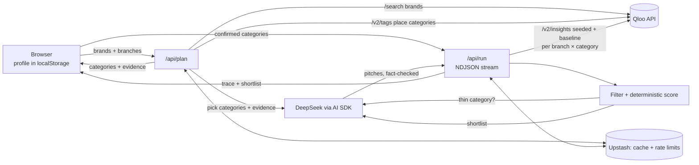

# Perk Desk

> Card-linked offer platforms show where members spend. Perk Desk shows which local merchants to sign first.

**Live app:** https://perk-desk.vercel.app (no login, no access code)

Perk Desk is a research agent for the one person who runs the member-perks program at a small credit union. You give it your branches and the brands your members already love. Perk Desk uses Qloo's taste graph to find **unsigned, independent local merchants** near each branch, ranks them, and hands you a shortlist of about 10 merchants. Each merchant comes with evidence, a map pin, a short recruiting pitch and a follow-up status. You can export the list as a CSV.

Built for the **Qloo Agentic Hackathon: Agents, but with taste** (Devpost) with the Qloo API, DeepSeek (via the Vercel AI SDK), Next.js, Leaflet/OpenStreetMap, Upstash and Vercel.

**Merchant-selection tool. Not used for any credit decision or consumer ad targeting.**

---

## Why

- Members want offers at the coffee shop, gym or bike shop around the corner. Card-linked cashback platforms mostly offer national brands.
- A community credit union usually has one part-time marketing person for the perks program. They can contact only a handful of merchants each quarter. Which ones should they call first?
- Popular places are easy to find. The question is which local places **these members** will care about, and that is a taste question. Qloo answers it.

## How it works

1. **Profile (one time, saved only in your browser).** Credit union name, city, and 1–5 branches. Find branches by institution name (Qloo place search), type an address, or pick a point on the map. Each branch has a trade-area radius (default 6 km, 1–20 km). Add the merchants you have already signed and, optionally, your business members. You can type them or import a CSV/text file.
2. **Member taste.** Enter 1–10 aggregated brand names (for example your members' top brands from card spend data). Or click a quick segment: Dining, Coffee & desserts, Bars & craft beer, Pets, Fitness, Beauty & hair.
3. **Plan (`POST /api/plan`).** The agent resolves each brand in Qloo, then searches Qloo's place categories and proposes 2–6 categories. **Every category must cite a real Qloo tag of one of your brands.** The agent then stops.
4. **You confirm.** Check the brand matches, remove or add categories (up to 5), and confirm. Nothing is searched before you confirm. Your edits are saved as preferences for the next plan.
5. **Research (`POST /api/run`, streamed).** For every branch × category, Perk Desk asks Qloo for nearby places **twice**: once seeded with your member brands, once without (the baseline). It filters and scores the results in plain code, then checks for thin categories. The agent may try one adjacent category per thin category.
6. **Shortlist.** About 10 merchants spread across branches, each with a pitch written by DeepSeek and checked in code. The results come with a map, follow-up statuses, an "Independents only" filter and a CSV export.



## How Perk Desk uses Qloo

Qloo does the core work. Without the taste graph, Perk Desk would only produce a "popular places nearby" list.

| Qloo endpoint | What Perk Desk does with it | Why it matters |
|---|---|---|
| `GET /search` (`types=urn:entity:brand`) | Resolves each member brand to a Qloo entity (top 3 candidates; exact/prefix match wins; the agent settles ambiguous names such as "REI"). Also used as a chain check on shortlisted merchant names. | Turns plain brand names into taste signals with tags. |
| `GET /search` (place search near the city) | "Find branches": looks up your credit union's branches by name (credit union / federal credit union / bank genres, open, within 50 km). | Sets up branches in seconds instead of typing addresses. |
| `GET /v2/tags` (`urn:tag:category:place`) | The agent searches Qloo's real place categories. Each chosen category must cite one of the brand's Qloo tags as evidence. | Brand taste → which kinds of local shops to look at, with an explanation. |
| `GET /v2/insights` (`filter.type=urn:entity:place`, `filter.location` + radius, `filter.tags`) | Twice per branch × category: **seeded** with `signal.interests.entities` = your member brands and `feature.explainability=true`, and a **baseline** without the signal. | The difference between the two rankings is the taste signal. Explainability shows which member brands drive each match. |
| `GET /v2/insights` with `filter.location.query` | Approximate location for typed addresses and city centers. | No separate geocoding service. |

Place details on the cards (address, phone, website, hours, `business_rating`, Tripadvisor rating, description) come from Qloo place data. We do not call Tripadvisor or Google directly.

## Scoring (deterministic, in `src/lib/merchants/scoring.ts`)

For each branch × category, Perk Desk merges the seeded list and the baseline list:

- **rank_lift** = baseline rank − seeded rank. A merchant missing from the baseline gets baseline rank = baseline length + 1. Example: `+11 places vs. baseline` means member taste moved it up 11 places compared with plain local popularity.
- **affinity**: Qloo's affinity, min-max normalised within the same branch × category.
- **distance**: 1 − distance / branch radius.
- **rating**: `business_rating` / 5. If missing, Tripadvisor rating / 5. If both are missing, 0.5.

`score = 0.40 × affinity + 0.25 × lift + 0.20 × distance + 0.15 × rating`. Lift is normalised as `clamp((rank_lift + 10) / 20, 0, 1)`. Merchants with a taste signal sort first, then by score.

Before scoring, the code drops closed places, noise genres (malls, supermarkets, hotels, stadiums, gas stations and similar), merchants you marked Signed or Not a fit, names on your signed list, national chains (from a curated name list), and places outside the branch radius (+10% slack). Merchants with 2+ locations of the same name are kept but flagged **Multi-location brand**. "Independents only" hides them. The shortlist takes about 10 merchants (`SHORTLIST_TOTAL = 10`), split evenly across branches and round-robin across categories.

**Pitch guard:** a pitch must name the merchant, have at most 3 sentences and at most 600 characters, and **every number in it must appear on the merchant's card**. Pitches that fail fall back to a template.

**Fallback mode:** if DeepSeek is missing, fails or times out, the app still runs on Qloo. Brand matching and category rules run in code, pitches come from a template, and the UI shows "Fallback mode".

## Judge quick start (about 2 minutes)

1. Open https://perk-desk.vercel.app. Under **"Or explore a demo with a fictional credit union"**, click **Try Denver demo** or **Try Austin demo**. Both are fictional credit unions with their branches, signed merchants and member brands filled in.
2. Click **Plan merchant categories**. Review the recognized brands and the category chips with their Qloo evidence, then click **Confirm & find merchants**.
3. Watch the live agent trace. Then open the shortlist: cards with rank lift, member-brand shares, ratings and pitch, plus the map. Try **Independents only**, change a status, and **export the CSV**.

**Try your own credit union:** click **Start with my credit union**. Enter the name and city (`City, ST`), use **Find branches** or add a branch manually or on the map, enter a few member brands, then click **Plan merchant categories** and **Confirm & find merchants**. If you are not sure what to enter, try **Bellco Credit Union** with `Denver, CO`, or **University Federal Credit Union** with `Austin, TX`. If Find branches returns nothing, you can still add a branch by address or by picking a point on the map.

Demo presets replay cached research when the inputs are unchanged: the plan returns in about a second and the full result streams in about 5 seconds. Replays do not count toward the limits. If you edit a demo, or use your own credit union, Perk Desk runs live research.

## Privacy and trust

- No accounts, no login. Your profile (institution, city, branches, signed and business-member lists, category preferences, follow-up statuses) is stored **only in your browser's localStorage** (`perkdesk:v1:profile`).
- Aggregated brand names only. No member-level, age, gender, income or ZIP data. Qloo brand tags about target age, gender or income are filtered out before they reach the model, the UI or the cache.
- API keys stay on the server. Server usage logs contain a short SHA-256 hash of the IP, never the raw IP or keys.
- The demo institutions are fictional. No Qloo response data is committed to this repo.

## Limits

Live research is free for everyone, with daily limits (from `src/lib/config.ts`):

| | Per IP / day | Global / day | Max Qloo calls per request |
|---|---|---|---|
| Plan | 30 | 300 | 70 |
| Research run | 10 | 150 | 120 |
| Find branches | 30 | 300 | 2 |

Cached requests, including the demos, are unlimited. A run that hits its call cap returns what it has gathered and says "Stopped early to stay within the research budget". The server gives a plan up to 2 minutes and a research run up to 4 minutes. In our production tests, research runs finished in about 10–15 seconds when Qloo data was already cached. Runs for a new credit union take longer, depending on how much Qloo data is already cached.

## Run locally

Requires Node.js 20.9+ and macOS, Linux or WSL.

```bash
npm install
cp .env.example .env.local   # then fill in the values below
npm run dev                  # http://localhost:3000
```

Environment variables (names only; server-side, never prefix with `NEXT_PUBLIC_`):

| Name | Required | Purpose |
|---|---|---|
| `QLOO_API_KEY` | yes | Qloo hackathon API key |
| `DEEPSEEK_API_KEY` | for agent mode | Without it the app runs in fallback mode |
| `UPSTASH_REDIS_REST_URL`, `UPSTASH_REDIS_REST_TOKEN` | required in Vercel production | Shared cache and rate limits. Locally an in-memory store is used |
| `QLOO_BASE_URL`, `DEEPSEEK_MODEL`, `PD_AGENT_DISABLED` | optional | Overrides. `PD_AGENT_DISABLED=1` forces fallback mode |

In Vercel production, live research returns HTTP 503 if the Upstash values are missing or the rate-limit store is unavailable. Cached results still work.

## Tests

```bash
npm test              # 1,391 offline unit tests (97 files), no live API calls
npm run lint
npx tsc --noEmit
npm run check:privacy # scans tracked files for secrets and private data
npm run smoke         # live end-to-end check (uses Qloo, and DeepSeek if configured)
npm run eval          # live category-selection eval (15 brand lists)
```

## Known limitations

- **Member brands must come from the credit union.** Real member taste data (for example top brands from card spend data or a member survey) is something only the credit union has. The demos use fictional brand lists. In production a credit union would export its aggregated top brands and paste or upload them.
- **Qloo coverage varies.** Category tags and place data come from Qloo and can be imperfect. Small credit unions may not be listed in Qloo, and acronyms or name variants can miss in "Find branches". Add those branches manually or on the map.
- **Typed addresses are approximate.** Without a map pick, a typed address resolves to its Qloo locality (often 0.5–3 km off). The UI asks you to pick the exact point on the map.
- **Refresh behavior.** Refreshing keeps the saved profile and follow-up statuses. Member brands, "Find branches" candidates and research results are kept in memory only and are cleared. Re-running the same inputs usually hits the cache.
- **Statuses live in one browser.** No sync, no reminders. Only Signed and Not a fit are excluded on the next run. Contacted is a label only.
- **Multi-location brands** are flagged with a badge and the Independents only filter, not removed.
- **Shared daily limits.** When they are used up, live research pauses until the next day. The demos keep working.
- No email sending, accounts or server-side profile storage (by design).

## Docs

`docs/PRD.md` (product), `docs/ARCHITECTURE.md` (design), `docs/QLOO_API.md` (Qloo endpoints and verified behavior), `docs/PROGRESS.md` (build log).

## License

MIT. See [`LICENSE`](LICENSE).
