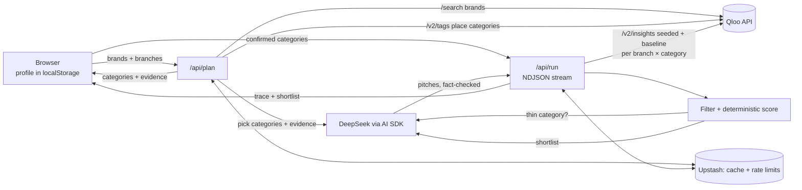

# Perk Desk

> **One-line:** Perk Desk turns the brands a credit union's members already love into a shortlist of local merchants to sign first — ranked by Qloo taste, not plain popularity.

**Live demo (no login):** https://perk-desk.vercel.app

Built for the **Qloo Agentic Hackathon: Agents, but with taste** (Devpost) with the Qloo API, DeepSeek (Vercel AI SDK), Next.js, Leaflet/OpenStreetMap, Upstash, and Vercel.

**Merchant-selection tool. Not used for any credit decision or consumer ad targeting.**

---

## Try it in 30 seconds

1. Open https://perk-desk.vercel.app.
2. Under **"Or explore a demo with a fictional credit union:"**, click **Try Denver demo** (or **Try Austin demo**).
3. Click **Plan merchant categories** → review **Recognized brands** and **Categories to research** → **Confirm & find merchants**.
4. On **Your merchant shortlist**, look for **`+N places vs. baseline`** (rank lift), member-brand shares, the map, **Independents only**, **Copy pitch**, status, and **Export CSV**.

Unchanged demos replay a cached research result in about 5 seconds and do not count toward daily limits. Edited demos and new profiles run live research.

<!-- SCREENSHOT / GIF SLOTS (capture plan: submission/v2/screenshots.md)
     1. [gallery] Shortlist card with rank lift + map — gallery thumbnail
     2. Setup: fictional Denver demo + Member brands
     3. Choose your merchant categories (evidence)
     4. Research progress (seeded vs baseline steps)
     5. Full shortlist + Independents only + Export CSV
-->

---

## Why this exists

- Members want perks at the coffee shop, gym, or bike shop around the corner. Card-linked platforms mostly push national brands.
- A community credit union often has **one** part-time marketer for the perks program. They can call only a handful of merchants each quarter. **Which ones first?**
- Popular places are easy to find. The hard question is which local places **these members** will care about. That is a taste question. **Qloo answers it.**

---

## How it works

```text
Member brands + branches
        │
        ▼
  /api/plan  ── Qloo /search (brands) + /v2/tags (place categories)
        │         agent proposes categories with evidence
        ▼
  You confirm  ── nothing is searched until you click Confirm
        │
        ▼
  /api/run   ── Qloo /v2/insights twice per branch × category
        │         (seeded with brands) vs (baseline without)
        ▼
  Filter + score in code  →  shortlist + checked pitches + map + CSV
```

1. **Profile (browser only).** Credit union name, city, 1–5 branches (Find branches / address / map). Optional signed-merchant and business-member lists. Stored in `localStorage` (`perkdesk:v1:profile`). No accounts.
2. **Member taste.** Enter 1–10 aggregated brand names, or pick a quick segment (Dining, Coffee & desserts, Bars & craft beer, Pets, Fitness, Beauty & hair).
3. **Plan.** Agent resolves brands in Qloo and proposes 2–6 place categories. **Every category must cite a real Qloo tag of one of your brands.** Then it stops.
4. **You confirm.** Edit brands/categories (up to 5 for the run). Research starts only after **Confirm & find merchants**.
5. **Research (NDJSON stream).** For every branch × category: Qloo places **seeded** with member brands (`feature.explainability=true`) and a **baseline** without the signal. Code filters noise/chains/signed, scores, may retry one adjacent category if thin.
6. **Shortlist.** About 10 merchants: rank lift, brand shares, ratings, pitch, map, follow-up status, Independents only, CSV export.



---

## Why Qloo (and why an agent with guards)

**Hackathon story / pitch:** see the Devpost project page (add public URL after submit). This README stays a repo guide — setup, architecture, and tests.

Without Qloo, Perk Desk would only list popular places nearby. Rank lift exists only because we compare the **same** place query **with** member brands and **without** them, plus explainability brand shares.

**What the agent decides:** ambiguous brand matches, which place categories to propose, one adjacent retry when a category is thin, and recruiting pitches.

**What stays in code (guards):**
- Categories must come from this run's Qloo tags and cite a real brand tag (checked in code).
- Human confirm before any merchant search.
- Deterministic score: `0.40×affinity + 0.25×lift + 0.20×distance + 0.15×rating` (`src/lib/merchants/scoring.ts`). The LLM never ranks merchants.
- Pitch guard: ≤3 sentences, ≤600 chars, must name the merchant, **every number must appear on the card** — else a template.
- **Fallback mode:** if DeepSeek is missing/fails, the app still runs on Qloo with rule-based categories and template pitches.

### How Perk Desk uses Qloo

| Qloo endpoint | What Perk Desk does | Why it matters |
|---|---|---|
| `GET /search` (`types=urn:entity:brand`) | Resolve member brands (top 3; exact/prefix preferred; agent settles ambiguity e.g. "REI"). Chain check on shortlisted names. | Brand names → taste entities + tags. |
| `GET /search` (places near city) | **Find branches** by institution name. | Fast setup. |
| `GET /v2/tags` (`urn:tag:category:place`) | Agent searches real place categories; each pick cites a brand tag. | Brand taste → which local shop types, with evidence. |
| `GET /v2/insights` (places + location + radius + tags) | **Twice** per branch × category: seeded with `signal.interests.entities` + explainability, and baseline without. | Rank lift = taste signal. Brand shares explain the match. |
| `GET /v2/insights` (`filter.location.query`) | Approximate geocode for typed addresses / cities. | No separate geocoder. |

Place details on cards (address, phone, website, hours, ratings, description) come from Qloo place data.

### Scoring (deterministic)

- **rank_lift** = baseline rank − seeded rank. Missing from baseline → baseline rank = baseline length + 1. UI example: `+11 places vs. baseline`.
- Affinity min-max normalised within branch × category; distance = 1 − distance/radius; rating from `business_rating` then Tripadvisor then 0.5.
- Lift normalised as `clamp((rank_lift + 10) / 20, 0, 1)`. Taste-signal merchants sort first.
- Filters drop closed places, noise genres, signed/not-a-fit, national chains, out-of-radius. Multi-location brands are flagged; **Independents only** hides them. Shortlist ~10 (`SHORTLIST_TOTAL = 10`).

---

## Privacy and trust

- No accounts. Profile stays in the browser only.
- Aggregated brand names only — no member-level, age, gender, income, or ZIP data. Demographic Qloo brand tags are filtered before model/UI/cache.
- API keys stay on the server. Usage logs store a short SHA-256 of the IP, never the raw IP or keys.
- Demo institutions are **fictional**. No raw Qloo response payloads are committed to this repo.

## Limits

| | Per IP / day | Global / day | Max Qloo calls / request |
|---|---|---|---|
| Plan | 30 | 300 | 70 |
| Research run | 10 | 150 | 120 |
| Find branches | 30 | 300 | 2 |

Cached requests (including demos) are unlimited. A run that hits its call cap returns what it has. Server deadlines: plan 2 minutes, research 4 minutes.

## Run locally

Requires Node.js 20.9+ (macOS, Linux, or WSL).

```bash
npm install
cp .env.example .env.local   # fill in the values below
npm run dev                  # http://localhost:3000
```

| Name | Required | Purpose |
|---|---|---|
| `QLOO_API_KEY` | yes | Qloo hackathon API key |
| `DEEPSEEK_API_KEY` | for agent mode | Without it → Fallback mode |
| `UPSTASH_REDIS_REST_URL`, `UPSTASH_REDIS_REST_TOKEN` | required on Vercel production | Shared cache + rate limits (in-memory locally) |
| `QLOO_BASE_URL`, `DEEPSEEK_MODEL`, `PD_AGENT_DISABLED` | optional | Overrides; `PD_AGENT_DISABLED=1` forces fallback |

## Tests

Verified with `npx vitest list` against `tests/unit/**/*.test.ts` (no live Qloo/DeepSeek calls):

```bash
npm test              # 1,457 offline unit tests (102 files)
npm run lint
npx tsc --noEmit
npm run check:privacy # secrets / private-data scan
npm run smoke         # live end-to-end (needs keys)
npm run eval          # live category-selection eval (15 brand lists)
```

## Known limitations

- Member brands must come from the credit union (aggregated). Demos use fictional lists.
- Qloo coverage varies; small CUs may miss in Find branches — add branches manually or on the map.
- Typed addresses are approximate without a map pick.
- Refresh keeps profile + statuses; brands/results in memory are cleared (same inputs usually hit cache).
- Statuses are per-browser; only Signed and Not a fit are excluded on the next run.
- Shared daily limits; demos keep working when live research is paused.
- No email sending, accounts, or server-side profiles (by design).

## Docs

`docs/PRD.md` · `docs/ARCHITECTURE.md` · `docs/QLOO_API.md` · `docs/PROGRESS.md`

## License

MIT. See [`LICENSE`](LICENSE).
